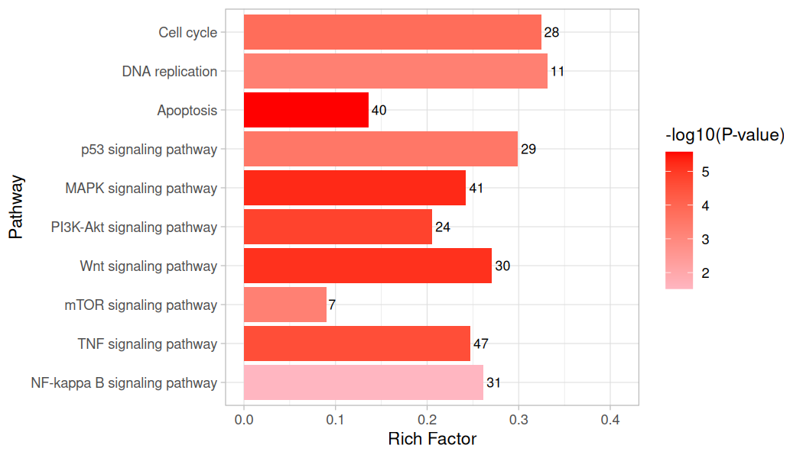
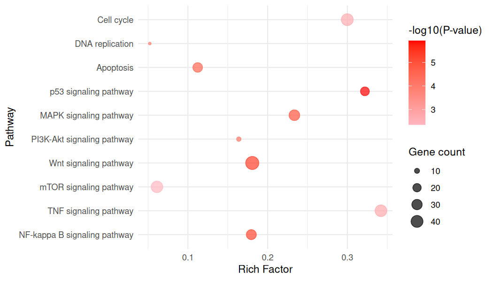
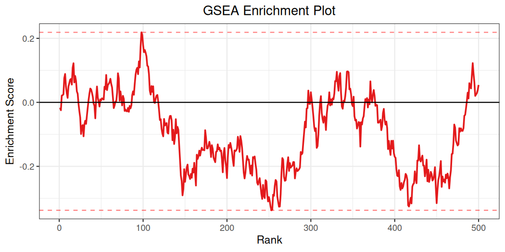
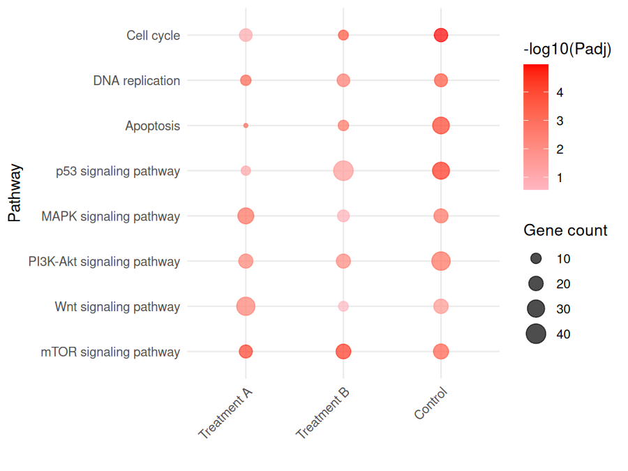
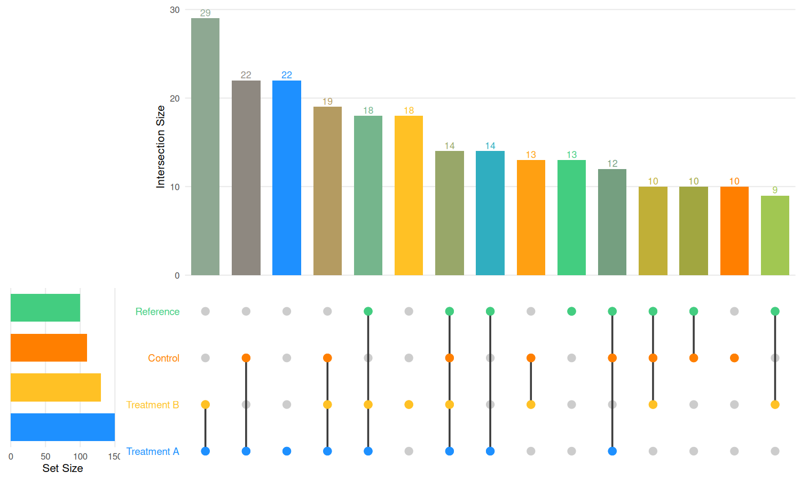

# richR 

[](http://www.repostatus.org/#active)
[](https://github.com/hurlab/richR)
[](https://github.com/hurlab/richR/actions/workflows/R-CMD-check.yaml)

[](https://zenodo.org/badge/latestdoi/243827597)

## Overview

**richR** is an R package for functional enrichment analysis and visualization.
It supports Over-Representation Analysis (ORA) via hypergeometric testing,
Gene Set Enrichment Analysis (GSEA), and kappa-score-based term clustering.
Built-in annotation builders cover GO, KEGG, Reactome, KEGG Module, and MSigDB,
and you can supply custom gene sets via GMT files or named lists.

### Key features

- **Enrichment**: `richGO()`, `richKEGG()`, `enrich()`, `richGSEA()`
  (`richDAVID()` is deprecated: RDAVIDWebService is no longer available from
  Bioconductor, and the function will be removed in the next minor release)
- **Clustering**: `richCluster()` groups terms by kappa similarity
- **20+ visualization functions** including bar, dot, lollipop, heatmap, network,
  volcano, circle bar, gene-dot, gene-heat, gene-bar, UpSet, and more
- **dplyr support**: `filter()`, `select()`, `mutate()`, `arrange()`, `group_by()`,
  `slice()`, `summarise()` work directly on enrichment result objects
- **Batch analysis**: `batchEnrich()` runs enrichment across multiple gene lists
- **Comparison**: `compareResult()` and `richCompareDot()` for multi-group comparisons
- **Publication-quality UpSet plots** with pixel-accurate panel alignment and
  intuitive color-blended multi-set bars (`richUpset()`)

## Installation

```r
# Install from GitHub
library(devtools)
install_github("hurlab/richR")
```

Bioconductor annotation packages are needed for building annotations:
```r
BiocManager::install(c("org.Hs.eg.db", "GO.db"))       # human GO
BiocManager::install("reactome.db")                      # Reactome (optional)
```

## Quick Start

### 1. Build annotation data

```r
library(richR)

# Check available species
showData()

# Build GO and KEGG annotations
hsago <- buildAnnot(species = "human", keytype = "SYMBOL", anntype = "GO")
hsako <- buildAnnot(species = "human", keytype = "SYMBOL", anntype = "KEGG")

# KEGG Module
hsakom <- buildAnnot(species = "human", keytype = "SYMBOL", anntype = "KEGGM")

# MSigDB
hsamgi <- buildMSIGDB(species = "human", keytype = "SYMBOL", anntype = "GO")

# Reactome (needs reactome.db installed; it does not have to be attached)
hsaro <- buildAnnot(species = "human", keytype = "SYMBOL", anntype = "Reactome")
```

In an annotation, `Term` (like `GOALL`, `PATH` and `Module`) is the
identifier column and `Annot` holds the label. Reactome annotations keep the
pathway identifier (`R-HSA-...`) in `Term` and the pathway name in `Annot`, so
pathways that share a name stay separate gene sets.

KEGG pathway labels come from the bundled snapshot by default. With
`builtin = FALSE` they are read from live KEGG; when that listing fails, richR
warns and uses the bundled labels instead. The label source actually used
(`"KEGGREST"` or `"bundled"`) and the labels' retrieval date are recorded: an
`Annot` keeps them in `enrichmentInfo(hsako)$provenance$annotation$label_source`,
and a `richKEGG()` result in `enrichmentInfo(resko)$provenance$labels`. A live
KEGG annotation also records the KEGG version when KEGG states one (its
release, or `last update YYYY-MM-DD`) in `label_source$release` and
`source_version`.

### 2. Run enrichment analysis

```r
# GO enrichment (ORA)
gene <- sample(unique(hsago$GeneID), 1000)
resgo <- richGO(gene, godata = hsago, ontology = "BP")
head(resgo)

# KEGG enrichment
resko <- richKEGG(gene, kodata = hsako, pvalue = 0.05)
# Results: Annot holds the identifier ("04110"), Term the label ("Cell cycle")

# Significance cutoffs: a term is reported when Pvalue <= pvalue AND
# Padj <= padj (defaults pvalue = 0.05, padj = 0.05)
resko_raw <- richKEGG(gene, kodata = hsako, padj = NULL)          # raw p only
resko_adj <- richKEGG(gene, kodata = hsako, pvalue = 1)           # Padj only
resko_all <- richKEGG(gene, kodata = hsako, pvalue = 1, padj = 1) # no cutoff

# GSEA (requires a named numeric vector)
genelist <- rnorm(1000)
names(genelist) <- sample(unique(hsako$GeneID), 1000)
res_gsea <- richGSEA(genelist, object = hsako)
```

For ORA, `universe = NULL` uses all unique genes in the eligible annotation.
An explicit universe is intersected with those annotated genes, so unannotated
IDs do not contribute to the background:

```r
background <- unique(hsago$GeneID)
resgo <- richGO(gene, godata = hsago, ontology = "BP", universe = background)
info <- enrichmentInfo(resgo)
info$input$effective_count
info$background$effective_count

# Object-preserving dplyr operations keep the original run's metadata snapshot.
filtered <- dplyr::filter(resgo, Pvalue < 0.05)
enrichmentInfo(filtered)$testing$tested_count
```

The analysis, comparison and plot functions apply one significance rule: a
term is kept when `Pvalue <= pvalue` and, unless `padj` is `NULL`,
`Padj <= padj`. The defaults are `pvalue = 0.05` and `padj = 0.05`. Two
functions do not filter: `richVolcano()` draws every row and uses the cutoffs
only for its dashed reference line (at `padj`, or at `pvalue` when
`padj = NULL`), and `richGSEAcurve()` applies the rule only when it picks the
pathways itself, never to explicit `pathways` or `pathway_pattern`
selections.
`padj = NULL` filters on the raw p-value only, `pvalue = 1` on the adjusted
p-value alone, and `pvalue = 1, padj = 1` switches significance filtering
off. Cutoffs must lie in (0, 1]. Rows removed at analysis time are not kept
in the result, so a later plot with looser cutoffs cannot bring them back;
run the analysis with `pvalue = 1, padj = 1` if you want to choose cutoffs
later. Their statistics are still recorded in the tested table
(`testedTerms()`, see "Tested terms, comparing and storing results").

ORA counts each valid query ID once. Adjusted p-values cover the terms whose
annotated size lies in [`minGSSize`, `maxGSSize`] and that share at least one
gene with the query (the clusterProfiler/DOSE convention);
`padj.family = "all"` adjusts over every size-eligible term instead, with
zero-overlap terms contributing p = 1. The default family is a convention,
not an FDR guarantee. `minSize`, `maxSize`, `keepRich` and the cutoffs are
applied afterwards and never change an adjusted value. With
`keepRich = TRUE`, fully rich terms (`RichFactor == 1`) are exempt from the
`minSize` filter only; with the default sizes (`minGSSize = 10`,
`minSize = 2`) this changes nothing.

`enrichmentInfo()` reports input mapping, effective background, tested-family,
annotation, and provenance details. Legacy objects without recorded metadata
return `available = FALSE`. The snapshot describes the original analysis after
object-preserving operations such as `filter()` and `arrange()`; extracting a
data frame (for example, with `result()` or `as.data.frame()`) carries no
metadata guarantee.

GSEA accepts optional backend controls. `NULL` leaves each control out of the
backend call, preserving its defaults. `nproc` and `BPPARAM` cannot be supplied
together. A supplied `seed` restores the caller's random-number state on
success or error. Repeated seeded calls are reproducible with serial execution:

```r
res_gsea <- richGSEA(genelist, object = hsako, eps = 0,
                     scoreType = "std", nproc = 1, seed = 123)
```

`padj.method` is applied to p-values for the full backend-returned pathway set
before result filtering, so choosing a non-BH method can change adjusted
p-values.

GSEA gene sets are keyed by annotation identifier: `pathway` holds the
identifier (for example `04110` for a KEGG pathway) and the `Term` column
holds its label. Select pathways by label with `Term`, not `pathway`:

```r
subset(result(res_gsea), Term == "Cell cycle")
```

`parGSEA()` forwards the same controls. With `simplify = FALSE` it returns a
`GSEAResult` with metadata; `simplify = TRUE` returns a data frame.

#### Auditing identifiers, choosing N and checking stability

`mapGenes()` converts identifiers and records one decision per input entry;
a one-to-many identifier is dropped as `ambiguous` (or, with
`multiple = "first"`, kept as its first candidate with the count recorded),
never picked silently. `mappingAudit()` reads the decisions back, for the
converted vector or for any result analysed from it:

```r
ens <- mapGenes(entrez_ids, "human", "ENTREZID", "ENSEMBL")
mappingAudit(ens)                 # one row per input id: decision, target, reason
res <- enrich(ens, ens_annot)
mappingAudit(res)                 # input id -> mapping decision -> engine decision
```

By default `N` counts the universe genes annotated in the tested annotation.
`universe_policy = "measured"` (with an explicit `universe`) also counts the
measured genes the annotation does not cover:

```r
enrich(genes, annot, universe = measured_genes, universe_policy = "measured")
```

`richSensitivity()` re-runs `enrich()` over named backgrounds and `maxGSSize`
bounds and summarises, per term, how often it was reported among the cells
that tested it. The summary is descriptive, not a statistical test:

```r
g <- richSensitivity(genes, annot,
                     backgrounds = list(annotation = NULL, measured = measured_genes),
                     maxGSSize = c(500, 1000))
g$summary
```

### 3. Custom gene sets

```r
# Import from GMT file (MSigDB, Enrichr, etc.)
annot <- readGMT("h.all.v2023.2.Hs.symbols.gmt", species = "human")
res <- enrich(my_genes, annot)

# From a named list
my_sets <- list(
  "Apoptosis"  = c("TP53", "BAX", "BCL2", "CASP3"),
  "Cell Cycle" = c("CDK1", "CDK2", "CCND1", "RB1")
)
annot <- buildAnnotFromList(my_sets)
res <- enrich(my_genes, annot)
```

Named gene-set lists and batch input lists require unique, nonblank names;
duplicate names are rejected. If a GMT file contains repeated term names,
`readGMT()` merges their memberships in first-seen order and warns once.

### 4. Custom annotation with bioAnno

```r
# library(bioAnno)
# fromKEGG(species = "ath")
# athgo <- buildOwn(dbname = "org.ath.eg.db", anntype = "GO")
# athko <- buildOwn(dbname = "org.ath.eg.db", anntype = "KEGG")
# See https://github.com/guokai8/bioAnno for details
```

## Visualization

richR provides **20+ visualization functions**. All accept `richResult`,
`GSEAResult`, or `data.frame` objects and support saving to file via
`filename`, `width`, and `height` arguments. Each function has a `rich*`
primary name and backward-compatible `gg*` aliases.

### Term-level summary plots

Classic plots that rank and display enriched terms:

```r
# Bar plot — horizontal bars of gene count per term, colored by significance
richBar(resgo, top = 20, usePadj = FALSE)

# Dot plot — bubble plot: x = RichFactor, y = Term, size = gene count, color = -log10(p)
richDot(resko, top = 10, usePadj = FALSE)

# Lollipop — clean alternative to bar plot: x = RichFactor, color = significance
richLollipop(resko, top = 20)

# Circular bar plot — polar-coordinate bar chart of enrichment terms
richCircle(resko, top = 15)
```

<p align="center">
  
  
</p>

### Scatter and volcano plots

Two-axis continuous plots for exploring enrichment structure:

```r
# Scatter — enrichment funnel plot (MA-plot analogy for enrichment)
#   x = log10(pathway size), y = log2(fold enrichment), color = -log10(p)
#   Small pathways (left) can have extreme FE by chance; large pathways
#   (right) with high FE are the most robust findings
richScatter(resgo, top = 50, label.top = 5)
richScatter(resko, usePadj = FALSE)

# Volcano — enrichment volcano plot
#   x = effect size (log2 FE for ORA, NES for GSEA)
#   y = -log10(p), color = effect (diverging gradient), size = -log10(p)
#   Labels auto-adjusted via ggrepel; works for both ORA and GSEA
richVolcano(resgo)                               # ORA: x = log2(Fold Enrichment)
richVolcano(res_gsea)                            # GSEA: x = NES
richVolcano(resgo, label.top = 10, short = TRUE) # customize labels

# Term similarity scatter — MDS projection of gene-set overlap (Jaccard)
#   Functionally related terms cluster together in 2D space
richTermSim(resko, top = 20)
```

### Gene-level plots

Show which genes drive the enrichment:

```r
# Gene-term dot plot — color by fold change (if provided) or -log10(p)
richGeneDot(resgo, fc = my_foldchanges)
richGeneDot(resgo)                              # no fc: color by -log10(Pvalue)

# Gene-term heatmap — pheatmap-style tile plot with borders
#   Missing gene-term combinations shown as grey; supports fold-change coloring
richGeneHeat(resgo, fc = my_foldchanges)
richGeneHeat(resgo, na.fill = "grey90", border.color = "grey40")

# Gene bar plot — bars per term with gene labels aligned inside
richGeneBar(resgo, top = 10)
```

### GSEA-specific plots

```r
# NES bar plot — up/down color-coded by enrichment direction
richNES(res_gsea, top = 20)

# Running enrichment score curve (classic GSEA plot)
richGSEAcurve(object = hsako, gseaRes = res_gsea)
# pathways: identifier ("04110"), KEGG id with organism prefix ("hsa04110"),
# or a unique Term label; explicit selections are not significance-filtered
richGSEAcurve(object = hsako, gseaRes = res_gsea, pathways = "hsa04110")

# ECDF step plot — cumulative rank distribution of gene sets
richECDF(res_gsea)
```



### Network and map plots

```r
# Gene-concept network — bipartite graph of terms and their genes
richNetplot(resko, top = 20)

# Term similarity network — edges weighted by gene-set overlap (kappa)
richNetwork(resgo, top = 20, weightcut = 0.01)

# Combined network map — overlay multiple enrichment results
richNetmap(list(resgo, resko), top = 50)
```

### Cluster and comparison plots

```r
# Kappa-based clustering of enrichment terms
resc <- richCluster(resgo)
richClusterDot(resc)

# Multi-group comparison
resko1 <- richKEGG(gene1, kodata = hsako)
resko2 <- richKEGG(gene2, kodata = hsako)
res_cmp <- compareResult(list(S1 = resko1, S2 = resko2))
richCompareDot(res_cmp)

# Keep every group's x-axis label, including groups with no retained terms
res_cmp_all <- compareResult(list(S1 = resko1, S2 = resko2), include.all = TRUE)
richCompareDot(res_cmp_all, include.all = TRUE)

# Comparison heatmap across multiple analyses
richHeatmap(list(GO = resgo, KEGG = resko), top = 50)
```



### UpSet plot

`richUpset()` renders an UpSet-style plot (intersection bar chart +
dot matrix + set-size bars) for visualizing overlaps between named
gene lists. Built entirely with ggplot2 — no dependency on the UpSetR
package. Key features:

- **Pixel-accurate bar-to-dot alignment** — the intersection bar chart
  and the dot matrix are pre-aligned with `cowplot::align_plots()` and
  positioned via `ggdraw()` + `draw_plot()`, so the bars always line
  up with the dots beneath them regardless of y-axis label widths.
- **Blended multi-set bar colors** — single-set bars keep the set
  color; multi-set intersection bars are rendered in an RGB blend of
  the participating set colors, making each combination visually
  distinct. Set `main.bar.color` to force a uniform color.
- **Flexible input** — named list of character vectors, list of
  `richResult` / `GSEAResult` objects, or data frames with a `GeneID`
  / `leadingEdge` column.

```r
set.seed(123)
all_genes <- paste0("GENE", seq_len(250))
gene_lists <- list(
  "Treatment A" = sample(all_genes, 150),
  "Treatment B" = sample(all_genes, 130),
  "Control"     = sample(all_genes, 110),
  "Baseline"    = sample(all_genes, 100)
)

richUpset(gene_lists)

# Custom colors and ordering
richUpset(gene_lists,
          mycol = c("dodgerblue", "goldenrod1", "seagreen3", "orchid3"),
          order.by = "degree", nintersects = 20)

# Uniform bar color override
richUpset(gene_lists, main.bar.color = "steelblue")
```



### Plot summary table

| Function | Plot type | x-axis | y-axis | Color | Size |
|---|---|---|---|---|---|
| `richBar` | Bar | Gene count | Term | -log10(p) | — |
| `richDot` | Bubble | RichFactor | Term | -log10(p) | Gene count |
| `richLollipop` | Lollipop | RichFactor | Term | -log10(p) | — |
| `richCircle` | Circular bar | Gene count | Term (polar) | -log10(p) | — |
| `richScatter` | Funnel/MA | log10(Pathway Size) | log2(Fold Enrichment) | -log10(p) | — |
| `richVolcano` | Volcano | Effect (log2 FE / NES) | -log10(p) | Effect | -log10(p) |
| `richTermSim` | MDS scatter | Dim 1 | Dim 2 | -log10(p) | Gene count |
| `richNES` | Bar (GSEA) | NES | Term | Up/Down | — |
| `richECDF` | Step | NES rank | Cumulative fraction | — | — |
| `richGeneDot` | Dot matrix | Gene | Term | FC / -log10(p) | — |
| `richGeneHeat` | Heatmap | Gene | Term | FC / presence | — |
| `richGeneBar` | Stacked bar | RichFactor | Term | Gene labels | — |
| `richNetplot` | Network | — | — | — | — |
| `richNetwork` | Network | — | — | -log10(p) | Gene count |
| `richUpset` | UpSet | Intersection | Set size | Group | — |

## Working with results

```r
# Extract result table and detail table
result(resgo)
detail(resgo)

# Get genes for specific terms
getGenes(resgo, term = "GO:0006955")

# dplyr verbs work directly
library(dplyr)
resgo %>% filter(Padj < 0.01) %>% head()
resgo %>% select(Term, Pvalue, Padj)
resgo %>% arrange(Pvalue) %>% head(10)

# Batch enrichment across multiple gene lists
gene_lists <- list(GroupA = gene1, GroupB = gene2)
batch_res <- batchEnrich(gene_lists, annot = hsago)
batch_res$status  # success, empty, or failed for each original group
batch_res$combined # exact rows returned by each successful enrichment
```

`compareResult()` applies the shared significance rule to every group
(`Pvalue <= pvalue` and, unless `padj = NULL`, `Padj <= padj`; defaults
0.05 and 0.05) without further guards. With
`include.all = TRUE`, its `group` column is a factor with levels in input
order that retains every supplied group label, even when the group has no
significant terms;
`richCompareDot(..., include.all = TRUE)` keeps those labels on the x-axis
without adding placeholder terms, and draws every input row without
applying its own cutoffs. `batchEnrich()` preserves valid empty
results, combines the rows already returned by each group without applying a
second cutoff, and returns a `status` data frame with `group`, `status`,
`n_terms`, and `error` columns. A zero-row enrichment is `empty`; an exception
is `failed` and retains its error message.

### Tested terms, comparing and storing results

A result records what was tested, not only what was reported. `result(x)`
holds the reported rows; `testedTerms(x)` holds every tested term (ORA: every
term of the tested family that overlaps the query; GSEA: every pathway fgsea
returned), with the same columns and a logical `reported` column:

```r
tested <- testedTerms(resgo)
table(tested$reported)
enrichmentInfo(resgo)$testing$zero_overlap_count  # zero-overlap terms, counted not listed
```

`zero_overlap_count` is non-zero only with `padj.family = "all"`. dplyr verbs
change only `result(x)`: the tested table and `enrichmentInfo()` stay those of
the original analysis. Objects saved by richR before 0.2.0 have no tested
table; `testedTerms()` returns `NULL` with a warning and nothing is
reconstructed.

`bindRich()` binds results of one class into one long table, one row per group
and term, without applying cutoffs or inventing values:

```r
bound <- bindRich(batch_res$results)   # or bindRich(list(A = res1, B = res2))
table(bound$group, bound$state)
```

The columns start with `group`, the identifier (`Annot` or `pathway`),
`Term`, `state` and `execution`, followed by the groups' result columns.
`execution` is `success`, `empty` or `failed` (a `NULL` entry). `state` says
whether the group `reported` the term, tested it without reporting it
(`tested_not_reported`), did not test it (`not_tested`), could only have tested it with
zero overlap (`untested_or_zero_overlap`, with `padj.family = "all"`), or
cannot tell (`unavailable`, for objects without a tested table); it is `NA`
for a failed group. Statistics come only from the group's own record and are
`NA` otherwise; a missing value is never written as `0`.

`writeRich()` stores a result as a folder of UTF-8 tab-separated tables
(`result.tsv`, `tested.tsv`, `detail.tsv` or `input.tsv`) and a
`manifest.json`; `readRich()` reads it back exactly:

```r
writeRich(resgo, "resgo_rich")
resgo2 <- readRich("resgo_rich")
identical(result(resgo2), result(resgo))   # TRUE
```

Doubles are written with 17 significant digits, special characters are
escaped and missing values are written `\N`, so values, identifiers such as
`"00010"` and the `enrichmentInfo()` record come back unchanged. `readRich()`
accepts folder format version 1 with metadata `schema_version` 1 or 2 and
stops with an error, rather than guessing, on anything it cannot read exactly.

### Themes of related terms

`richThemes()` groups the terms reported by one result, or by several results
of one class, into themes of related terms, and `themeGenes()` drills down from
a theme to its genes in each group:

```r
th <- richThemes(batch_res$results)   # or richThemes(list(A = res1, B = res2))
th$themes                             # one row per theme
th$themes$label[1] <- "cell cycle"    # labels are editable; tables link by theme_id
themeGenes(th, "theme_001")           # genes x groups, with the members listing each gene
fc <- list(A = data.frame(gene = names(fcA), log2FC = fcA),
           B = data.frame(gene = names(fcB), log2FC = fcB))
themeGenes(th, "theme_001", stats = fc)  # joins your statistics by gene
```

Only terms reported in at least one group are grouped. Two terms are compared
by Cohen's kappa of their evidence genes — ORA overlap genes or GSEA
leading-edge genes, unioned over the groups that report the term — and joined
by average-linkage clustering when their average kappa is at least `cutoff`
(default 0.5). Every reported term is in exactly one theme; no term is dropped
and single terms stay as their own theme. The representative is the member most
similar to the others, not the most significant one, and the default label is
its `Term`. `th$members` holds the original `bindRich()` rows, `th$genes` the
evidence genes per group, `th$similarity` the kappas, and `th$settings` the
method, cutoff and each group's `enrichmentInfo()` record. In `themeGenes()`, a
missing statistic is `NA` with a reason in `stat_status`, never `0`.

A theme summarizes the listed terms; it is not a statistical test and has no
p-value of its own (a representative's p-value is not the theme's). Related or
overlapping gene sets are not independent replications, so the number of terms
in a theme is not a measure of evidence, and evidence genes are not shown to be
causal drivers. Themes can change when a group is added or removed, because the
evidence genes pool the supplied groups.

## Function name aliases

All plotting functions use the `rich*` prefix as the primary name.
Old `gg*` names are kept as backward-compatible aliases:

| Primary name | Aliases |
|---|---|
| `richBar` | `ggbar` |
| `richDot` | `ggdot` |
| `richLollipop` | `gglollipop`, `ggLollipop` |
| `richGeneDot` | `gggenedot`, `ggGeneDot` |
| `richGeneHeat` | `gggeneheat`, `ggGeneHeat` |
| `richGeneBar` | `gggenebar`, `ggGeneBar` |
| `richCircle` | `ggcircbar`, `ggCircBar` |
| `richVolcano` | `ggvolcano`, `ggVolcano` |
| `richNES` | `ggNES`, `ggnes` |
| `richScatter` | `ggscatter`, `ggScatter` |
| `richECDF` | `ggecdf`, `ggECDF` |
| `richTermSim` | `ggtermsim`, `ggTermSim` |
| `richNetplot` | `ggnetplot` |
| `richNetwork` | `ggnetwork` |
| `richNetmap` | `ggnetmap` |
| `richUpset` | `ggupset` |
| `richHeatmap` | `ggheatmap` |
| `richClusterDot` | `ggcluster` |
| `richCompareDot` | `comparedot` |
| `richGSEAplot` | `ggGSEA` |
| `richGSEAcurve` | `plotGSEA` |

## Citation

If you use richR in your research, please cite:

```
Guo K and Hur J (2026). richR: Functional enrichment analysis and visualization.
R package version 0.1.5. https://github.com/hurlab/richR
```

Upstream releases and their historical DOIs are maintained at
[guokai8/richR](https://github.com/guokai8/richR); the hurlab fork
tracks upstream and ships fix-ahead patches (currently the
`richUpset()` alignment fix and multi-set color blending, proposed
upstream as PR #9 — pending merge at time of writing).

## Contact

For questions or bug reports on the hurlab fork, please open an
[issue on GitHub](https://github.com/hurlab/richR/issues).
For issues affecting upstream, please file at
[guokai8/richR](https://github.com/guokai8/richR/issues).
